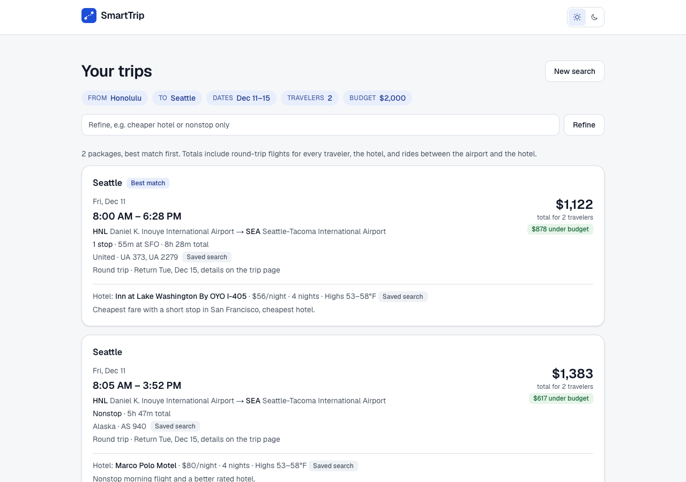
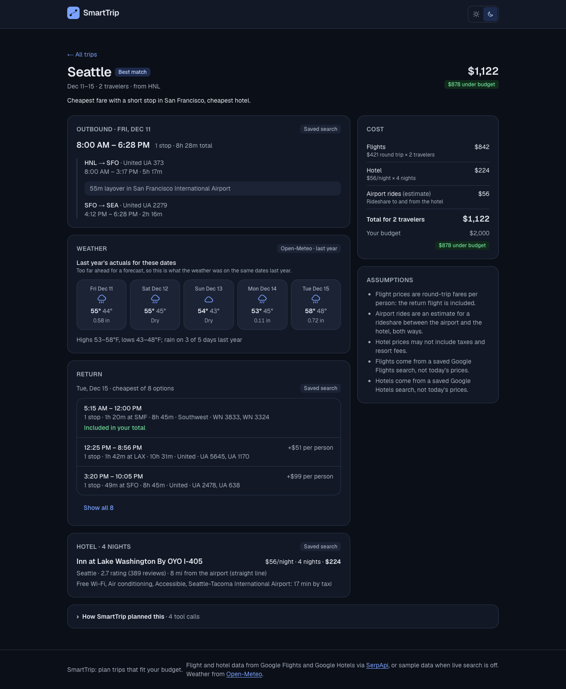
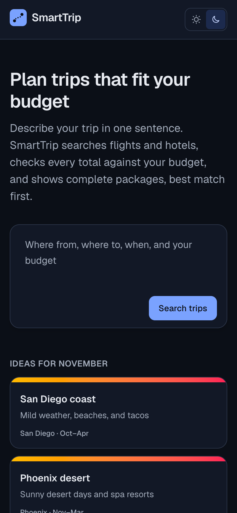

# SmartTrip

Describe a trip in one sentence ("2 of us, Honolulu to Seattle Dec 11-15, $2,000") and SmartTrip returns complete flight and hotel packages that fit the budget, best match first. An AI agent reads the request, asks one question if something essential is missing, and searches real Google Flights and Google Hotels data. Every total is computed by the server, never by the model, and every piece of data says where it came from.



| Trip page | Phone, dark |
|---|---|
|  |  |

All 12 screenshots (3 pages, desktop and phone, light and dark) are in [docs/screenshots/](docs/screenshots/).

## What it does

- **One free-text box**, with seasonal idea cards that fill it in. Relative dates ("the weekend after next") and vague destinations ("somewhere warm") are understood.
- **One clarifying question at most.** A request without a budget or an origin gets a single question, and the answer continues the same search.
- **Results like Google Flights:** outbound times, stops and layovers, red-eyes, airline and flight numbers, the hotel, the total for all travelers against the budget, and the agent's reason for each package.
- **Editable request chips and a refine box** ("cheaper hotel"). Each change is a new search that continues the conversation and links back to the previous results.
- **A trip page** with the outbound legs, real return-flight options, the hotel, the weather for each day, a cost breakdown that adds up to the total, the assumptions behind it, and every tool call the agent made.
- **Source badges everywhere:** Live, Cached 3h ago, Saved search, Sample data, or Open-Meteo forecast or last year's actuals.

## How it works

```
Browser                         Next.js server (one process)
  /  (search box)   ── POST /api/run ──▶  runAgent ──▶ LLM (course gateway or OpenRouter)
  /results/[runId]  ◀─ NDJSON progress ──    │
  /results/[runId]/[tripId]                  │ MCP client ── in-memory transport ── MCP server (createServer)
       │                                     │                                       ├─ lookupAirport
       └─ POST .../return (on click)          │                                       ├─ searchFlights ─┐
                                              │                                       ├─ searchHotels ──┼─ SerpApi (24h cache, caps)
                                              │                                       ├─ getWeather ────┼─ Open-Meteo
                                              │                                       └─ presentTrips   │
                                              └─ run store (memory + data/runs/*.json)                  └─ data/cache/
```

- **The agent** (`agent/runAgent.ts`) calls `recordRequest` first: what it understood (the chips), or its one question. It then searches and finishes with `presentTrips`, which looks up each flight and hotel by id, computes every total, ranks within-budget trips first, adds weather, and rejects reasons that mention prices.
- **Tools are a real MCP server** (`mcp-server/`), run in-process for the web app and over stdio for the MCP Inspector (`npm run mcp`).
- **SerpApi** calls go through one helper with a 24-hour disk cache, a per-run cap, and a monthly counter. Follow-up searches reuse the conversation's earlier results instead of searching again.
- **Weather** comes from Open-Meteo: a forecast up to 16 days ahead, and beyond that last year's actual weather for the same dates, always labelled.
- **Runs are saved** (memory and `data/runs/`), so results pages, refines, and return flights work by run id.

## Running it

Requires Node 20+.

```
npm install
cp .env.example .env.local      # then fill in the keys
npm run dev                     # http://localhost:3000
```

`.env.local` settings (see `.env.example` for all of them):

| Variable | What it does |
|---|---|
| `LLM_API_KEY` | Course LLM gateway key (or set `OPENROUTER_API_KEY` to use OpenRouter). |
| `LLM_DEFAULT_MODEL` | Gateway model; the demo used `claude-haiku-4.5`. |
| `FLIGHT_PROVIDER`, `HOTEL_PROVIDER` | `mock` (default, no key), `fixture` (saved real searches), or `serpapi` (live). |
| `SERPAPI_API_KEY` | Needed for `serpapi`. The free plan has 250 searches a month. |
| `DEMO_FALLBACK=offline` | Manual switch for a demo without SerpApi: saved searches where they exist, sample data otherwise, no live calls. |

Other commands:

| Command | What it does |
|---|---|
| `npm run build && npm run start` | Production server (faster than dev). |
| `npm run check` | All tests. Offline: a scripted fake LLM, saved fixtures, no API calls. |
| `npm run lint` | ESLint. |
| `npm run seed:runs` | Saves 8 example runs (no model, no API) to browse at `/results/00000000-0000-4000-8000-00000000000N`. |
| `npm run demo:check` | Checks the gateway, SerpApi, Open-Meteo, and disk space, then warms the cache for the demo requests (asks before spending searches). |
| `npm run mcp` | The MCP server over stdio, for the MCP Inspector. |
| `npm run plan -- "<request>"` | The agent from the command line. |

The demo itself is described step by step in [docs/demo-runbook.md](docs/demo-runbook.md).

## Data sources

- **Flights and hotels:** Google Flights and Google Hotels via [SerpApi](https://serpapi.com), or saved real searches in `data/fixtures/`, or sample data in `data/flights.json` and `data/hotels.json`.
- **Weather:** [Open-Meteo](https://open-meteo.com) (free, no key).
- **Airports:** [OurAirports](https://ourairports.com) (public domain), built into `data/airports.json` by `scripts/build-airports.ts`.

## Limits

- Hotel prices are per room per night; rooms are not multiplied for 3 or more travelers (the trip page says so).
- Weather more than 16 days ahead is last year's actual weather for the same dates, not a forecast.
- Airport rides are a rideshare estimate from the straight-line distance between the hotel and the airport.
- Sample data covers flights from Honolulu to about a dozen cities; saved real searches cover Honolulu to Seattle, Dec 11-15, 2026.
- The SerpApi free plan allows 250 searches a month; the cache and caps keep usage low, but heavy live use will run out.
- It runs locally for now; there is no deployment or access control yet.

## Next steps

1. Activities near each hotel (Google Maps via SerpApi) with a daily allowance in the totals, and a map on the trip page.
2. Deployment: shared storage for runs and the cache, and access control so a public link can't spend the API quota.

Accessibility: Lighthouse scores 100 on the landing, results, and trip pages; colors are checked for contrast by `npm run check`.
